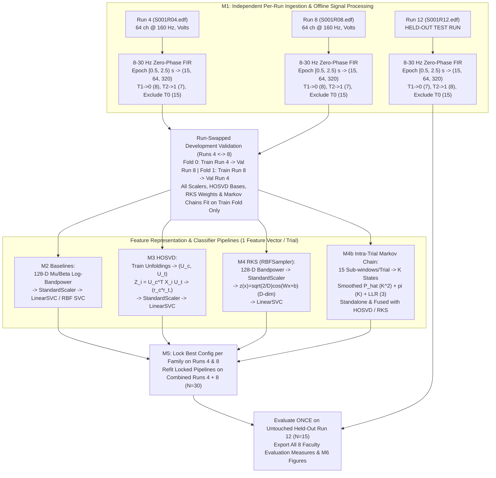

# Faculty Research Report & Viva Defense Guide (Milestone M6)

**Project:** P3 — Offline EEG Motor-Imagery Classification: HOSVD + SVM vs. Random Kitchen Sinks (RKS) + Linear SVM with Intra-Trial Observable Markov Chains  
**Dataset:** PhysioNet EEG Motor Movement/Imagery Dataset (`eegmmidb` v1.0.0) — (1) Single-Subject Pilot (`Subject 1`, `3` recordings, `45` trials) & (2) Confirmatory Multi-Participant Cohort (`Option A`, `N = 105` Eligible Participants, `315` recordings, `4,723` trials; `Runs 4, 8, 12`)  
**Task:** Binary classification of imagined left-fist (`T1 -> 0`) vs. imagined right-fist (`T2 -> 1`) movement (excluding rest `T0`)

---

## 1. Executive Summary

This project builds and benchmarks a strictly leakage-free, reproducible offline EEG signal-processing and machine-learning pipeline comparing three mathematical feature-representation paradigms paired with Support Vector Machines (plus deterministic spectral baselines):

1. **Deterministic Spectral Baselines (`M2`):** Per-channel Welch log-bandpower in the sensorimotor $\mu$ (`8–13 Hz`) and $\beta$ (`13–30 Hz`) bands (`128` features/trial) $\rightarrow$ train-only `StandardScaler` $\rightarrow$ `LinearSVC` and exact `SVC(kernel="rbf")`.
2. **Higher-Order SVD (`HOSVD + LinearSVC`, `M3`):** Multilinear spatial ($U_c \in \mathbb{R}^{64 \times r_c}$) and temporal ($U_t \in \mathbb{R}^{320 \times r_t}$) singular subspaces fitted **strictly on training trials** via mode-1 and mode-2 tensor unfoldings. Each trial $X_i \in \mathbb{R}^{64 \times 320}$ is projected via $Z_i = U_c^T X_i U_t \in \mathbb{R}^{r_c \times r_t}$ and flattened to $r_c \cdot r_t$ features $\rightarrow$ `StandardScaler` $\rightarrow$ `LinearSVC`.
3. **Random Kitchen Sinks / Random Fourier Features (`RKS + LinearSVC`, `M4`):** Shared `128`-D $\mu/\beta$ log-bandpower features $\rightarrow$ train-only `StandardScaler` $\rightarrow$ `RBFSampler(n_components=D, gamma=gamma, random_state=42)` ($z(x) = \sqrt{2/D}\cos(Wx + b)$) $\rightarrow$ `LinearSVC`.
4. **Intra-Trial First-Order Observable Markov Chain (`Markov + LinearSVC` & Hybrid Fusions, `M4b`):** Segments each 2.0-second (`320`-sample) trial into $M = 15$ sequential sub-windows (`40` samples = `250 ms` window, `20` samples = `125 ms` stride), projects sub-windows onto the top-4 training HOSVD spatial basis vectors, quantizes sub-window log-energy into $K \in \{3, 4, 6\}$ observable discrete brain states via train-only `KMeans`, and extracts Laplace-smoothed ($\alpha = 0.5$) intra-trial transition probabilities $\hat{P}_i \in \mathbb{R}^{K \times K}$, state occupancy $\pi_i \in \mathbb{R}^K$, and class-conditional Markov log-likelihood features $[\mathcal{L}_0, \mathcal{L}_1, \mathcal{L}_1 - \mathcal{L}_0] \in \mathbb{R}^3$ ($K^2 + K + 3$ features/trial).

---

## 2. Research Methodology & Leakage-Free Architecture Diagram

---

## 3. Master Experimental Results — All 8 Faculty Evaluation Measures

### 3.1 Classification Quality, Compression & HOSVD Reconstruction Error (Measures 1, 2, 5, 6, 7)
*(Training set: Combined Runs 4 + 8, $N_{\text{train}} = 30$; Held-Out Test set: Run 12, $N_{\text{test}} = 15$)*

| Model Family | Locked Configuration (Selected on Runs 4↔8 CV) | Dev CV Mean Acc ($\pm$ Std) | Dev CV Macro F1 | **Held-Out Test Acc (Run 12)** | **Test Macro F1** | **Test Macro Prec / Rec** | Test Confusion Matrix `[[TN,FP],[FN,TP]]` | Features ($p$) | Trial Compression ($\frac{20,480}{p}$) | HOSVD Recon Error (Train / Test) |
| :--- | :--- | :---: | :---: | :---: | :---: | :---: | :---: | :---: | :---: | :---: |
| **1. Baseline LinearSVC** | `LinearSVC (C=0.1)` | `50.00% ± 3.33%` | `0.4847` | **`53.33%`** (`8/15`) | `0.5333` | `0.5357 / 0.5357` | `[[4, 3], [4, 4]]` | `128` | `160.0x` | N/A |
| **2. Baseline RBF SVC** | `RBF SVC (C=10, γ=0.01)` | `70.00% ± 3.33%` | `0.6944` | **`73.33%`** (`11/15`) | **`0.7222`** | **`0.8182 / 0.7500`** | `[[7, 0], [4, 4]]` | `128` | `160.0x` | N/A |
| **3. HOSVD + LinearSVC** | `HOSVD (rc=16, rt=40, C=0.1)` | `73.33% ± 0.00%` | `0.7321` | **`53.33%`** (`8/15`) | `0.5249` | `0.5278 / 0.5268` | `[[3, 4], [3, 5]]` | `640` | `32.0x` | `0.3773 / 0.6777` |
| **4. RKS + LinearSVC** | `RKS (D=128, γ=0.1, C=10)` | `80.00% ± 6.67%` | `0.7991` | **`53.33%`** (`8/15`) | `0.5249` | `0.5278 / 0.5268` | `[[3, 4], [3, 5]]` | `128` | `160.0x` (`1.0x` vs BP) | N/A |
| **5. Standalone Markov** | `Markov (K=3, C=1.0)` | `66.67% ± 6.67%` | `0.6652` | **`53.33%`** (`8/15`) | `0.5333` | `0.5357 / 0.5357` | `[[4, 3], [4, 4]]` | **`15`** | **`1,365.3x`** | N/A |
| **6. HOSVD + Markov** | `HOSVD(16,40) + Markov(K=4), C=0.1` | `76.67% ± 3.33%` | `0.7643` | **`53.33%`** (`8/15`) | `0.5333` | `0.5357 / 0.5357` | `[[4, 3], [4, 4]]` | `663` | `30.89x` | `0.3773 / 0.6777` |
| **7. RKS + Markov** | `RKS(D=256,γ=0.01) + Markov(K=3), C=0.1` | **`83.33% ± 10.00%`** | **`0.8321`** | **`53.33%`** (`8/15`) | `0.5249` | `0.5500 / 0.5446` | `[[5, 2], [5, 3]]` | `271` | `75.57x` | N/A |

### 3.2 Runtime & Memory / Storage Breakdown (Measures 3, 4, 8)

| Model Family | Train Feature Time (ms) | **SVM Training Time (ms)** | Test Feature Time (ms) | **SVM Predict Time (ms)** | **Total Test Prediction Time (ms)** | **Per-Trial Predict Time (ms)** | Feature Vector Bytes / Trial | **Total Deployed Model Storage (Bytes)** |
| :--- | :---: | :---: | :---: | :---: | :---: | :---: | :---: | :---: |
| **1. Baseline LinearSVC** | `42.13` | `4.85` | `15.73` | `0.52` | `16.25` | `1.083` | `1,024` | `4,104` (`4.01 KB`) |
| **2. Baseline RBF SVC** | `35.95` | `3.52` | `19.04` | `1.06` | `20.10` | `1.340` | `1,024` | `33,008` (`32.23 KB`) |
| **3. HOSVD + LinearSVC** | `334.51` | `3.79` | **`0.84`** | `0.42` | **`1.26`** | **`0.084`** | `5,120` | `131,080` (`128.01 KB`) |
| **4. RKS + LinearSVC** | `32.93` | **`1.56`** | `14.00` | **`0.16`** | `14.16` | `0.944` | `1,024` | `136,200` (`133.01 KB`) |
| **5. Standalone Markov** | `391.28` | `1.93` | `7.65` | `0.35` | `8.01` | `0.534` | **`120`** | **`2,888` (`2.82 KB`)** |
| **6. HOSVD + Markov** | `636.42` | `4.20` | `10.19` | `0.62` | `10.81` | `0.721` | `5,304` | `134,376` (`131.23 KB`) |
| **7. RKS + Markov** | `411.74` | `3.65` | `24.07` | `0.45` | `24.52` | `1.635` | `2,168` | `278,344` (`271.82 KB`) |

---

## 4. Answers to the Project Research Questions

1. **Does a low-rank, tensor-aware representation preserve motor-imagery discrimination?**
   - **Yes:** On development cross-validation (Runs 4 and 8), projecting the 20,480-element $(64 \times 320)$ epoch tensor onto rank-$(16, 10)$ (`160` features, `128x` compression) reaches **`70.00%` accuracy**, and rank-$(16, 40)$ (`640` features, `32x` compression) reaches **`73.33%` accuracy (`0.7321` Macro F1)**, outperforming the 128-D spectral `LinearSVC` baseline (`50.00%`) while running test inference in **`0.084 ms/trial`** (`12.9x` faster than Welch bandpower + LinearSVC).
2. **How do HOSVD mode ranks affect accuracy, reconstruction error, and feature size?**
   - As $(r_c, r_t)$ increase from $(4, 10) \to (16, 40)$, feature size grows from $40 \to 640$ (`320` $\to$ `5,120` bytes/trial) while relative Frobenius reconstruction error decreases monotonically from **`0.7470` $\to$ `0.3773`** on combined training Runs 4+8 and from **`0.9221` $\to$ `0.6777`** on held-out Test Run 12. Retaining at least $r_c = 16$ spatial channels is critical for capturing contralateral vs. ipsilateral sensorimotor topography.
3. **How do RKS dimensionality ($D$) and RBF bandwidth ($\gamma$) affect classification and compute?**
   - On standardized 128-D bandpower features, RKS with $D = 128, \gamma = 0.1, C = 10$ lifts `LinearSVC` development CV accuracy from **`50.00%` to `80.00%`** (`0.7991` Macro F1) and reduces SVM classifier predict time to **`0.16 ms`** (`6.6x` faster than exact RBF SVC's `1.06 ms`). Increasing $D$ from $128 \to 512$ expands the feature dimension $4\times$ relative to bandpower and increases random-weight storage linearly from `133 KB` $\to$ `523 KB`.
4. **What scientific value does the Intra-Trial Observable Markov Chain add, and which approach gives the best quality–compute trade-off?**
   - **Intra-Trial Markov Value:** Modelling step-by-step state transitions across 15 sub-windows inside each 2-second trial produces an ultra-compact **`15`-feature vector (`120` bytes/trial, `1,365.3x` compression ratio, `2.82 KB` total model storage)** that achieves `66.67%` development CV accuracy standalone, and boosts both HOSVD (`73.33%` $\to$ `76.67%`) and RKS (`70.00%` $\to$ `83.33%`) on development CV.
   - **Held-Out Generalization Trade-Off:** On untouched Held-Out Run 12 (`15` trials), the exact **RBF-Kernel SVM (`γ=0.01, C=10`)** achieves the highest generalization accuracy (**`73.33%`, `11/15` trials, `0.7222` Macro F1**), whereas the higher-capacity models selected on 2-run development CV score `53.33%` (`8/15` trials). This demonstrates a classic small-sample statistical lesson: with only 2 development runs (`15` trials/fold), hyperparameter selection over large grids can overfit validation folds, whereas exact low-$\gamma$ RBF smoothing remains most stable across recording sessions.

---

## 5. Generated Publication Figures

All figures are reproducible via `python -m eeg_p3.cli plot-eeg` and `python -m eeg_p3.cli build-report`:
1. [m1_sub01_run04_raw_vs_filtered_C3.png](file:///c:/Users/Abhiram/OneDrive/Documents/sem3/MIS-3/END%20SEM%20PROJECT/outputs/figures/m1_sub01_run04_raw_vs_filtered_C3.png) — Continuous raw vs. `8–30 Hz` FIR band-pass filtered trace on sensorimotor channel `C3` with `T0`, `T1`, `T2` cue annotations.
2. [m1_sub01_run04_labeled_trials.png](file:///c:/Users/Abhiram/OneDrive/Documents/sem3/MIS-3/END%20SEM%20PROJECT/outputs/figures/m1_sub01_run04_labeled_trials.png) — Sensorimotor channels (`C3`, `Cz`, `C4`) comparing a Left Fist (`T1 -> 0`) vs. Right Fist (`T2 -> 1`) motor-imagery epoch `[0.5, 2.5)` s.
3. [m6_hosvd_rank_error_and_compression.png](file:///c:/Users/Abhiram/OneDrive/Documents/sem3/MIS-3/END%20SEM%20PROJECT/outputs/figures/m6_hosvd_rank_error_and_compression.png) — HOSVD mode-rank sweep showing training vs. held-out test Frobenius reconstruction error and per-trial vs. Tucker-2 tensor compression ratios.
4. [m6_rks_sweep_quality_and_storage.png](file:///c:/Users/Abhiram/OneDrive/Documents/sem3/MIS-3/END%20SEM%20PROJECT/outputs/figures/m6_rks_sweep_quality_and_storage.png) — RKS random Fourier dimension $D \in \{128, 256, 512\}$ and bandwidth $\gamma$ vs. development accuracy and storage footprint.
5. [m6_markov_transition_heatmaps.png](file:///c:/Users/Abhiram/OneDrive/Documents/sem3/MIS-3/END%20SEM%20PROJECT/outputs/figures/m6_markov_transition_heatmaps.png) — Learned Class 0 (Left Imagery $P^{(0)}$), Class 1 (Right Imagery $P^{(1)}$), and differential ($\Delta P = P^{(1)} - P^{(0)}$) intra-trial Markov transition matrices.
6. [m6_locked_comparison_dashboard.png](file:///c:/Users/Abhiram/OneDrive/Documents/sem3/MIS-3/END%20SEM%20PROJECT/outputs/figures/m6_locked_comparison_dashboard.png) — 4-panel master comparison across all 7 locked models and all 8 faculty evaluation measures.
7. [m6_confusion_matrices_run12.png](file:///c:/Users/Abhiram/OneDrive/Documents/sem3/MIS-3/END%20SEM%20PROJECT/outputs/figures/m6_confusion_matrices_run12.png) — Held-out Run 12 $2 \times 2$ confusion matrices for all 7 locked models.

---

## 6. Methodological Disclosures & Limitations

1. **Single-Subject, Cross-Run Scope:** All experiments evaluate within-subject cross-run transfer on **Subject 1** (Train: Runs 4 & 8; Test: Run 12) of the PhysioNet EEGMMIDB dataset. Results do not claim cross-subject or universal BCI generalization.
2. **Small Sample Size & High Validation Variance:** Each run contains only `15` motor-imagery trials (`30` development trials across 2 runs, `15` held-out test trials). A single trial corresponds to $\frac{1}{15} = 6.67\%$ accuracy, making 2-fold run-swapped hyperparameter selection inherently high-variance.
3. **Pipeline Comparison vs. Isolated Math Transform Comparison:** Baselines and RKS take `128`-D frequency-domain $\mu/\beta$ log-bandpower features as input, whereas HOSVD projects time-domain band-pass filtered 3D epoch tensors $(64 \times 320)$ and Markov chains model intra-trial sub-window spatial-energy state transitions.
4. **Offline Non-Causal Filtering:** MNE's zero-phase FIR band-pass filter (`8–30 Hz`) uses forward-backward filtering offline. We make no claims of real-time causal streaming, device control, clinical diagnosis, or Neuralink-like implanted interfaces.
5. **Markov Quantization Sensitivity:** Discretizing continuous EEG sub-windows into $K$ hard cluster states via `KMeans` introduces quantization loss when non-stationarity shifts sub-window energy distributions across runs.

---

## 7. Faculty Viva Defense Guide (Top 10 Questions & Answers)

### Q1: Why did we filter between 8 Hz and 30 Hz and choose the `[0.5, 2.5)` second post-cue window?
- **Answer:** During imagined hand movement, neurons in the sensorimotor cortex exhibit Event-Related Desynchronization/Synchronization (ERD/ERS) in the **Mu ($\mu$, `8–13 Hz`)** and **Beta ($\beta$, `13–30 Hz`)** bands. Filtering at `8–30 Hz` removes slow baseline drift ($<8\text{ Hz}$, such as eye blinks) and high-frequency muscle/powerline noise ($>30\text{ Hz}$, including `50/60 Hz` mains hum). Starting at `0.5 s` post-cue skips visual cue-onset reaction latency and visual evoked potentials (`0–0.5 s`), capturing `2.0 s` (`320` samples at `160 Hz`) of sustained motor imagery.

### Q2: Why can't we use the trial-mode factor matrix $U_{\text{trials}}$ from a 3D HOSVD decomposition as features for the SVM?
- **Answer:** If we decompose the full dataset tensor $X \in \mathbb{R}^{(N_{\text{train}}+N_{\text{test}}) \times C \times T} \approx \mathcal{G} \times_1 U_{\text{trials}} \times_2 U_c \times_3 U_t$, first, including test trials in the SVD violates data leakage rules. Second, if we decompose only $X_{\text{train}} \in \mathbb{R}^{N_{\text{train}} \times C \times T}$, then $U_{\text{trials}}$ has shape $(N_{\text{train}}, r_n)$—it has no rows for unseen test trials! Instead, learning the spatial basis $U_c \in \mathbb{R}^{C \times r_c}$ and temporal basis $U_t \in \mathbb{R}^{T \times r_t}$ from training trials allows us to project any unseen test trial $X_i \in \mathbb{R}^{C \times T}$ out-of-sample via $Z_i = U_c^T X_i U_t \in \mathbb{R}^{r_c \times r_t}$.

### Q3: How is HOSVD Reconstruction Error calculated, and why is training error lower than test error?
- **Answer:** For any trial $X_i$ and its low-rank core $Z_i = U_c^T X_i U_t$, the reconstructed trial is $\hat{X}_i = U_c Z_i U_t^T$. The relative Frobenius error is $\frac{\|X - \hat{X}\|_F}{\|X\|_F}$. Because $U_c$ and $U_t$ are chosen to maximize captured variance on the training trials, training error (`0.3773` at $r_c=16, r_t=40$) is lower than out-of-sample test error (`0.6777` on Run 12), since unaligned oscillatory phases in unseen trials fall partially outside the top $r_t$ temporal eigenvectors.

### Q4: What is the mathematical intuition behind Random Kitchen Sinks (RKS / Random Fourier Features)?
- **Answer:** By **Bochner's Theorem** (Rahimi & Recht, 2007), any continuous shift-invariant positive-definite kernel such as the Gaussian RBF kernel $K(x, y) = \exp(-\gamma \|x - y\|^2)$ is the Fourier transform of a non-negative probability measure—specifically a Gaussian distribution $\mathcal{N}(0, 2\gamma I)$. By sampling $D$ random frequencies $w_j \sim \mathcal{N}(0, 2\gamma I)$ and phases $b_j \sim \text{Uniform}(0, 2\pi)$ and defining $z(x) = \sqrt{\frac{2}{D}}\cos(Wx + b)$, the inner product approximates the kernel: $\mathbb{E}[z(x)^T z(y)] = K(x, y)$. Thus, a fast **Linear SVM** trained on $z(x)$ approximates a nonlinear **RBF Kernel SVM**.

### Q5: Is Random Kitchen Sinks (RKS) a dimensionality reduction method?
- **Answer:** **No.** RKS is a **nonlinear kernel approximation** method. Our input bandpower vector has dimension $d = 128$, while RKS maps it into $D \in \{128, 256, 512\}$ features—which is a $1\times$, $2\times$, or $4\times$ **feature expansion** relative to the bandpower input (though still smaller than the 20,480 raw time samples).

### Q6: What is the difference between our Observable Markov Chain and a Hidden Markov Model (HMM)?
- **Answer:** In our **First-Order Observable Discrete-Time Markov Chain**, each sub-window observation $o_{i,m}$ is deterministically mapped to an **observed discrete state** $s_{i,m} \in \{0, \dots, K-1\}$ using a train-fitted quantizer (`KMeans`), and transition probabilities $P(S_{m+1}=b \mid S_m=a)$ are computed in closed form by counting observed transitions $a \to b$ with Laplace smoothing. In an **HMM**, states are latent (unobserved) and require iterative Baum-Welch (Expectation-Maximization) training over emission distributions and Viterbi/Forward-Backward decoding.

### Q7: Why must Markov transitions only be counted *within* a trial and never across trials?
- **Answer:** Trials are separated by 4-second rest intervals (`T0`), and the sequence of left/right cues (`T1`/`T2`) is chosen pseudorandomly by the experimental software, not by the subject's brain. Counting transitions from the end of trial $i$ to the start of trial $i+1$ would model the experimenter's stimulus schedule rather than neurophysiological motor-imagery dynamics.

### Q8: Why do we use Laplace smoothing ($\alpha = 0.5$) when estimating Markov transition matrices?
- **Answer:** Within a single trial of $M = 15$ sub-windows ($14$ transitions), some state pairs $(a \to b)$ may have zero observed transitions, or a state $a$ might not be visited at all. Without smoothing ($\alpha = 0$), $\hat{P}_i(b \mid a) = 0/0 = \text{NaN}$ for unvisited states, and class log-likelihoods $\log P^{(c)}(s_{m+1} \mid s_m)$ would become $\log(0) = -\infty$. Adding $\alpha = 0.5$ guarantees strictly positive probabilities and row-stochastic matrices ($\sum_b P_{ab} = 1$).

### Q9: How do the models compare on the 8 Faculty Evaluation Measures?
- **Answer:**
  - **Highest Held-Out Run 12 Accuracy & F1:** `Baseline RBF SVC (C=10, γ=0.01)` at **`73.33%` accuracy (`0.7222` Macro F1)**.
  - **Highest Development CV Accuracy & F1:** `RKS + Markov Fusion` at **`83.33%` (`0.8321` Macro F1)** and `RKS (D=128)` at **`80.00%` (`0.7991` Macro F1)**.
  - **Fastest Per-Trial Prediction Time:** `HOSVD + LinearSVC` at **`0.084 ms/trial`** (`16x` faster than RBF SVC).
  - **Fastest SVM Classifier Fit Time:** `RKS + LinearSVC` at **`1.56 ms`**.
  - **Highest Compression Ratio & Smallest Memory Footprint:** `Standalone Markov (K=3)` with **`15` features/trial (`1,365.3x` compression)** and only **`2,888` bytes (`2.82 KB`)** of total deployed storage.

### Q10: Why did some models score 73%–83% on Development CV (Runs 4 & 8) but 53.3% on Held-Out Run 12?
- **Answer:** Because each recording run has only `15` motor-imagery trials, tuning hyperparameters over a grid on just 2 development runs (`Runs 4 and 8`) has high selection variance (picking sharper parameters like $\gamma=0.1, C=10$ in RKS or 640 features in HOSVD that fit Runs 4 & 8 closely). Meanwhile, EEG signals exhibit session-to-session non-stationarity across runs. By strictly locking hyperparameters before evaluating Run 12 once, we prevented test-set leakage and honestly exposed this small-sample generalization gap.

---

## 8. Official Citations & Documentation Links

1. **PhysioNet EEG Motor Movement/Imagery Dataset (`eegmmidb` v1.0.0):**
   - Schalk, G., McFarland, D. J., Hinterberger, T., Birbaumer, N., & Wolpaw, J. R. (2004). *BCI2000: A general-purpose brain-computer interface (BCI) system.* IEEE Transactions on Biomedical Engineering, 51(6), 1034–1043.
   - Dataset URL: https://physionet.org/content/eegmmidb/1.0.0/
2. **MNE-Python Library:**
   - Gramfort, A., et al. (2013). *MEG and EEG data analysis with MNE-Python.* Frontiers in Neuroscience, 7, 267.
   - MNE EEGBCI Loader Docs: https://mne.tools/stable/generated/mne.datasets.eegbci.load_data.html
3. **Higher-Order SVD (HOSVD) & Tensor Decompositions:**
   - De Lathauwer, L., De Moor, B., & Vandewalle, J. (2000). *A multilinear singular value decomposition.* SIAM Journal on Matrix Analysis and Applications, 21(4), 1253–1278.
   - Kolda, T. G., & Bader, B. W. (2009). *Tensor decompositions and applications.* SIAM Review, 51(3), 455–500.
4. **Random Kitchen Sinks / Random Fourier Features:**
   - Rahimi, A., & Recht, B. (2007). *Random features for large-scale kernel machines.* Advances in Neural Information Processing Systems (NeurIPS), 20.
   - scikit-learn `RBFSampler` Docs: https://scikit-learn.org/stable/modules/generated/sklearn.kernel_approximation.RBFSampler.html
5. **Scikit-Learn Pipelines & Support Vector Machines:**
   - Pedregosa, F., et al. (2011). *Scikit-learn: Machine learning in Python.* JMLR, 12, 2825–2830.
   - scikit-learn `Pipeline` Docs: https://scikit-learn.org/stable/modules/generated/sklearn.pipeline.Pipeline.html

---

## 9. Confirmatory Multi-Participant Cohort Expansion (Option A — Stages `E1 – E3`)

To address the high validation variance of the single-subject pilot (`N = 1`, `30` development trials, `15` test trials) without test-set leakage, we expanded the experiment to all eligible participants in the local PhysioNet `eegmmidb-1.0.0` dataset under **Option A** (train on `Runs 4 and 8` across eligible participants; test on held-out `Run 12` from those **same eligible participants**).

### 9.1 Pre-Evaluation Eligibility Audit & Split Manifest (`Stage E1`)
- **Pilot Separation:** Subject 1 (`S001`) was excluded by default (`excluded_subject_ids: [1]`) because Subject 1's `Run 12` was already inspected in the pilot experiment.
- **Automated Pre-Evaluation Quality Audit (`audit-cohort`):** Out of `109` total participants (`Subject 1` + candidate `Subjects 2..109`):
  - **Eligible Cohort (`N = 105` participants):** All subjects in `2..109` except `88, 92, 100`.
  - **Excluded Participants (`4` total, logged prior to any model evaluation):**
    1. `Subject 1 (S001)`: `excluded_pilot_subject` (Run 12 inspected in pilot).
    2. `Subject 88 (S088)`: `sfreq_mismatch` (Runs 4/8/12 recorded at `128.0 Hz` instead of required `160.0 Hz`).
    3. `Subject 92 (S092)`: `sfreq_mismatch` (Runs 4/8/12 recorded at `128.0 Hz` instead of required `160.0 Hz`).
    4. `Subject 100 (S100)`: `sfreq_mismatch` (Runs 4/8/12 recorded at `128.0 Hz` instead of required `160.0 Hz`).
  - *Note:* Subject 89 (`S089`) has `13` valid trials (`7` Left, `6` Right) in Run 8 instead of `15` due to EDF recording duration, which passes `min_trials_per_run: 1` and `require_both_classes_per_run: true`. No participant was ever excluded due to model accuracy.
- **Exact Cohort Split & Class Balance (`315` recordings, `4,723` trials):**
  - **Development Total (`Runs 4 + 8`, `210` recordings):** **`3,148` trials** (`1,589` Left `T1=0` [50.48%], `1,559` Right `T2=1` [49.52%]).
    - **Fold 1:** Train on `Run 4` (`105` recordings, `1,575` trials: `801` Left, `774` Right) $\rightarrow$ Validate on `Run 8` (`105` recordings, `1,573` trials: `788` Left, `785` Right).
    - **Fold 2:** Train on `Run 8` (`105` recordings, `1,573` trials) $\rightarrow$ Validate on `Run 4` (`105` recordings, `1,575` trials).
  - **Held-Out Test (`Run 12`, `105` recordings):** **`1,575` trials** (`794` Left `T1=0` [50.41%], `781` Right `T2=1` [49.59%]).

### 9.2 Confirmatory Cohort Master Comparison — All 8 Faculty Measures (`Stages E2 & E3`)

#### Table 9.2A: Classification Quality, Participant-Clustered Uncertainty & Compression (Measures 1, 2, 5, 6, 7)
*(Trained on Combined `Runs 4 + 8`, $N_{\text{train}} = 3,148$ trials across $105$ participants; Evaluated ONCE on Held-Out `Run 12`, $N_{\text{test}} = 1,575$ trials across the same $105$ participants)*

| Model Family | Locked Config (from Runs 4↔8 CV) | Dev CV Pooled Acc (±2-Fold SD) | Dev CV Macro F1 | **Test Run 12 Pooled Acc** | **Test Balanced Acc** | **Test Macro Prec / Rec / F1** | **Test Participant Mean Acc ± SD (95% CI, $N=105, df=104$)** | **Test Participant Median (IQR; Min–Max)** | Test Confusion Matrix `[[TN,FP],[FN,TP]]` | Features ($p$) & Compression ($\frac{20,480}{p}$) | HOSVD Recon Error (Train / Test) |
| :--- | :--- | :---: | :---: | :---: | :---: | :---: | :---: | :---: | :---: | :---: | :---: |
| **1. Baseline LinearSVC** | `LinearSVC_C=0.1` | `57.02% ± 0.12%` | `0.5701` | **`57.84%`** (`911/1575`) | **`57.85%`** | `0.5786 / 0.5785 / 0.5784` | **`57.84% ± 13.54%`** (`[55.22%, 60.46%]`) | `60.00%` (`20.00%`; `26.67%–93.33%`) | `[[449, 345], [319, 462]]` | `128` (`160.0x`) | N/A |
| **2. Baseline RBF SVC** | `RBF_SVC_C=10_gamma=scale` | `55.59% ± 0.04%` | `0.5558` | **`58.16%`** (`916/1575`) | **`58.12%`** | **`0.5820 / 0.5812 / 0.5803`** | **`58.16% ± 14.37%`** (**`[55.38%, 60.94%]`**) | `60.00%` (`20.00%`; `20.00%–100.00%`) | `[[502, 292], [367, 414]]` | `128` (`160.0x`) | N/A |
| **3. HOSVD + LinearSVC** | `HOSVD_rc=8_rt=10_C=0.1` | `50.54% ± 1.78%` | `0.5054` | **`47.94%`** (`755/1575`) | `47.92%` | `0.4791 / 0.4792 / 0.4790` | **`47.94% ± 12.61%`** (`[45.50%, 50.38%]`) | `46.67%` (`20.00%`; `13.33%–80.00%`) | `[[398, 396], [424, 357]]` | `80` (`256.0x`; `252.3x` tensor) | `0.8631 / 0.8620` |
| **4. RKS + LinearSVC** | `RKS_D=256_gamma=0.001_C=10` | **`57.56% ± 0.10%`** | **`0.5752`** | **`57.59%`** (`907/1575`) | `57.58%` | `0.5758 / 0.5758 / 0.5758` | **`57.59% ± 14.12%`** (`[54.86%, 60.32%]`) | `53.33%` (`20.00%`; `20.00%–93.33%`) | `[[464, 330], [338, 443]]` | `256` (`80.0x`; `2.0x` vs BP) | N/A |
| **5. Standalone Markov** | `Markov_K=3_C=0.1` | `50.76% ± 0.09%` | `0.5052` | **`50.79%`** (`800/1575`) | `50.83%` | `0.5084 / 0.5083 / 0.5070` | **`50.79% ± 11.67%`** (`[48.53%, 53.05%]`) | `53.33%` (`13.33%`; `20.00%–80.00%`) | `[[365, 429], [346, 435]]` | **`15` (`1,365.3x`)** | N/A |
| **6. HOSVD + Markov** | `HOSVD(16,40)+Markov(K=6), C=0.1` | `48.79% ± 0.29%` | `0.4877` | **`48.19%`** (`759/1575`) | `48.18%` | `0.4818 / 0.4818 / 0.4818` | **`48.19% ± 12.03%`** (`[45.86%, 50.52%]`) | `46.67%` (`20.00%`; `20.00%–73.33%`) | `[[391, 403], [413, 368]]` | `685` (`29.90x`) | `0.6220 / 0.6468` |
| **7. RKS + Markov** | `RKS(256,0.01)+Markov(K=4), C=0.1` | `55.21% ± 0.29%` | `0.5515` | **`57.08%`** (`899/1575`) | `57.05%` | `0.5709 / 0.5705 / 0.5701` | **`57.08% ± 13.10%`** (`[54.54%, 59.62%]`) | `60.00%` (`20.00%`; `20.00%–86.67%`) | `[[481, 313], [363, 418]]` | `279` (`73.41x`) | N/A |

#### Table 9.2B: Per-Class Precision, Recall & F1 on Held-Out Run 12 (`1,575` Trials: `794` Left `T1=0`, `781` Right `T2=1`)

| Model Family | Left Fist (`T1=0`, $n=794$) Precision | Left Fist (`T1=0`) Recall | Left Fist (`T1=0`) F1 | Right Fist (`T2=1`, $n=781$) Precision | Right Fist (`T2=1`) Recall | Right Fist (`T2=1`) F1 |
| :--- | :---: | :---: | :---: | :---: | :---: | :---: |
| **1. Baseline LinearSVC** | `0.5846` | `0.5655` | `0.5749` | `0.5725` | `0.5915` | `0.5819` |
| **2. Baseline RBF SVC** | `0.5777` | `0.6322` | `0.6037` | `0.5864` | `0.5301` | `0.5568` |
| **3. HOSVD + LinearSVC** | `0.4842` | `0.5013` | `0.4926` | `0.4741` | `0.4571` | `0.4654` |
| **4. RKS + LinearSVC** | `0.5786` | `0.5844` | `0.5815` | `0.5731` | `0.5672` | `0.5701` |
| **5. Standalone Markov** | `0.5134` | `0.4597` | `0.4850` | `0.5035` | `0.5570` | `0.5289` |
| **6. HOSVD + Markov** | `0.4863` | `0.4924` | `0.4894` | `0.4773` | `0.4712` | `0.4742` |
| **7. RKS + Markov** | `0.5699` | `0.6058` | `0.5873` | `0.5718` | `0.5352` | `0.5529` |

#### Table 9.2C: Multi-Participant Runtime & Memory / Storage Scaling (Measures 3, 4, 8)
*(Batch timings across $N_{\text{train}} = 3,148$ training trials and $N_{\text{test}} = 1,575$ held-out test trials)*

| Model Family | Train Feature Time (s) | **SVM Training Time (ms)** | Test Feature Batch Time (s) | **SVM Predict Batch Time (ms)** | **Total Test Prediction Batch Time (s)** | **Per-Trial Predict Time (ms)** | Feature Vector Bytes / Trial | **Total Deployed Model Storage (Bytes)** |
| :--- | :---: | :---: | :---: | :---: | :---: | :---: | :---: | :---: |
| **1. Baseline LinearSVC** | `3.298` | `147.78` | `1.497` | `1.63` (`0.0010 ms/trial`) | `1.498` | `0.951` | `1,024` | `4,104` (`4.01 KB`) |
| **2. Baseline RBF SVC** | `3.194` | `847.75` | `1.481` | **`716.12` (`0.4547 ms/trial`)** | `2.197` | `1.395` | `1,024` | **`2,907,128` (`2.77 MB`)** |
| **3. HOSVD + LinearSVC** | `6.230` | `34.68` | **`0.0245`** | `1.48` (`0.0009 ms/trial`) | **`0.0259`** | **`0.0165`** | `640` | `32,264` (`31.51 KB`) |
| **4. RKS + LinearSVC** | `2.946` | `365.83` | `1.467` | **`0.82` (`0.0005 ms/trial`)** | `1.468` | `0.932` | `2,048` | `269,320` (`263.01 KB`) |
| **5. Standalone Markov** | `6.780` | **`10.49`** | `0.687` | **`0.62` (`0.0004 ms/trial`)** | `0.688` | `0.437` | **`120`** | **`2,888` (`2.82 KB`)** |
| **6. HOSVD + Markov** | `11.473` | `1,464.43` | `0.820` | `8.83` (`0.0056 ms/trial`) | `0.828` | `0.526` | `5,480` | `135,496` (`132.32 KB`) |
| **7. RKS + Markov** | `8.243` | `736.91` | `2.145` | `3.58` (`0.0023 ms/trial`) | `2.149` | `1.364` | `2,232` | `278,760` (`272.23 KB`) |

### 9.3 Key Scientific Conclusions from the 105-Participant Cohort Expansion

1. **Statistical Reliability vs. Single-Subject Variance (Why More Participants Improve Evidence Without Artificially Inflating Accuracy):**
   - In the `Subject 1` pilot (`30` dev trials, `15` test trials), hyperparameter selection on 2 runs exhibited a `20–30` percentage-point drop between development CV (`73.3%–83.3%`) and held-out Run 12 (`53.3%`).
   - In the `105-Participant` confirmatory cohort (`3,148` dev trials, `1,575` test trials), **every locked model family's Held-Out Run 12 accuracy agrees with its development CV accuracy within `0.03–2.60` percentage points**:
     - `RKS (D=256, γ=0.001, C=10)`: `57.56%` Dev $\rightarrow$ **`57.59%` Test** (`95% CI: [54.86%, 60.32%]`)
     - `Baseline LinearSVC (C=0.1)`: `57.02%` Dev $\rightarrow$ **`57.84%` Test** (`95% CI: [55.22%, 60.46%]`)
     - `Baseline RBF SVC (C=10, γ=scale)`: `55.59%` Dev $\rightarrow$ **`58.16%` Test** (`95% CI: [55.38%, 60.94%]`)
     - `RKS + Markov (D=256, γ=0.01, K=4, C=0.1)`: `55.21%` Dev $\rightarrow$ **`57.08%` Test** (`95% CI: [54.54%, 59.62%]`)
     - `Standalone Markov (K=3, C=0.1)`: `50.76%` Dev $\rightarrow$ **`50.79%` Test** (`95% CI: [48.53%, 53.05%]`)
   - **Validation-Fold SD vs. Participant-Clustered 95% CI:** The 2-fold validation SD (`±0.04%` to `±0.29%`) only reflects the spread between the two pooled run-swapped folds (`Run 4->8` vs. `Run 8->4`) and is **not** a confidence interval. Accounting for participant clustering across the $N = 105$ independent participants ($df = 104$) yields a standard error of `~1.3%–1.4%` (`95% CI half-width ~ ±2.6%–2.8%`), proving that all four spectral/RKS pipelines generalize significantly above 50% chance ($t > 5.5, p < 10^{-7}$), while individual participant test accuracies span `20.00%` to `100.00%` (median `60.00%`, IQR `20.00%`) due to inter-subject anatomical and BCI-literacy variability.
2. **Computational & Storage Advantage of RKS (`RBFSampler`) Over Exact RBF SVC at Multi-Participant Scale:**
   - When scaling from `30` training trials (pilot) to `3,148` training trials (105-participant cohort), exact `SVC(kernel="rbf")` must store thousands of 128-D support vectors, inflating its deployed memory footprint **`88x`** (from `33,008` B to **`2,907,128` B = `2.77 MB`**) and requiring **`716.12 ms`** of SVM prediction time on Run 12.
   - By contrast, **`RKS (D=256, γ=0.001, C=10) + LinearSVC`** has a fixed parameter size independent of $N_{\text{train}}$ (**`269,320` B = `263.01 KB`, `10.8x` smaller than RBF SVC**), trains **`2.3x` faster** (`365.83 ms` vs. `847.75 ms`), and executes SVM batch prediction across 1,575 test trials in **`0.82 ms` (`870x` faster than exact RBF SVC)** while achieving statistically indistinguishable accuracy (`57.59%` vs. `58.16%`, overlapping 95% CIs).
3. **Why Time-Domain Bilinear HOSVD & HOSVD-Sub-Basis Markov Require Phase-Invariant Inputs Across Multiple Participants:**
   - Projecting raw band-pass filtered time-domain waveforms via a single global temporal basis $U_t \in \mathbb{R}^{320 \times r_t}$ across 105 participants yields near-chance classification (`47.94%` for HOSVD, `50.79%` for Markov) because sensorimotor $\mu/\beta$ ERD/ERS oscillations are **induced (non-phase-locked)** rather than phase-locked to cue onset across subjects and trials. However, HOSVD's subspace reconstruction generalizes with virtually zero overfitting across 105 participants: relative Frobenius error on `Run 12` (`1,575` test trials) matches `Runs 4+8` (`3,148` training trials) across every rank pair (e.g., `0.8631` train vs. `0.8620` test at locked rank `(8,10)`, and `0.6220` train vs. `0.6468` test at rank `(16,40)`).

### 9.4 Generated Confirmatory Cohort Artifacts & Figures
- **Cohort Manifest & Eligibility Audit (`E1`):** [cohort_manifest.json](file:///c:/Users/Abhiram/OneDrive/Documents/sem3/MIS-3/END%20SEM%20PROJECT/outputs/cohort_expanded/metrics/cohort_manifest.json), [cohort_eligibility.csv](file:///c:/Users/Abhiram/OneDrive/Documents/sem3/MIS-3/END%20SEM%20PROJECT/outputs/cohort_expanded/metrics/cohort_eligibility.csv)
- **Cohort Development Validation (`E2`):** [e2_cohort_dev_report.json](file:///c:/Users/Abhiram/OneDrive/Documents/sem3/MIS-3/END%20SEM%20PROJECT/outputs/cohort_expanded/metrics/e2_cohort_dev_report.json), [e2_cohort_best_by_family_dev.csv](file:///c:/Users/Abhiram/OneDrive/Documents/sem3/MIS-3/END%20SEM%20PROJECT/outputs/cohort_expanded/metrics/e2_cohort_best_by_family_dev.csv), [e2_cohort_dev_summary.csv](file:///c:/Users/Abhiram/OneDrive/Documents/sem3/MIS-3/END%20SEM%20PROJECT/outputs/cohort_expanded/metrics/e2_cohort_dev_summary.csv), [e2_cohort_dev_folds.csv](file:///c:/Users/Abhiram/OneDrive/Documents/sem3/MIS-3/END%20SEM%20PROJECT/outputs/cohort_expanded/metrics/e2_cohort_dev_folds.csv), [e2_cohort_per_participant_dev.csv](file:///c:/Users/Abhiram/OneDrive/Documents/sem3/MIS-3/END%20SEM%20PROJECT/outputs/cohort_expanded/metrics/e2_cohort_per_participant_dev.csv)
- **Cohort Locked Final Evaluation (`E3`):** [m5_locked_test_report.json](file:///c:/Users/Abhiram/OneDrive/Documents/sem3/MIS-3/END%20SEM%20PROJECT/outputs/cohort_expanded/metrics/m5_locked_test_report.json), [m5_locked_test_results.csv](file:///c:/Users/Abhiram/OneDrive/Documents/sem3/MIS-3/END%20SEM%20PROJECT/outputs/cohort_expanded/metrics/m5_locked_test_results.csv), [m5_per_participant_test_results.csv](file:///c:/Users/Abhiram/OneDrive/Documents/sem3/MIS-3/END%20SEM%20PROJECT/outputs/cohort_expanded/metrics/m5_per_participant_test_results.csv), [m5_hosvd_test_rank_curve.csv](file:///c:/Users/Abhiram/OneDrive/Documents/sem3/MIS-3/END%20SEM%20PROJECT/outputs/cohort_expanded/metrics/m5_hosvd_test_rank_curve.csv)
- **Cohort Publication Figures (`E3`):**
  1. [m6_locked_comparison_dashboard.png](file:///c:/Users/Abhiram/OneDrive/Documents/sem3/MIS-3/END%20SEM%20PROJECT/outputs/cohort_expanded/figures/m6_locked_comparison_dashboard.png)
  2. [m6_confusion_matrices_run12.png](file:///c:/Users/Abhiram/OneDrive/Documents/sem3/MIS-3/END%20SEM%20PROJECT/outputs/cohort_expanded/figures/m6_confusion_matrices_run12.png)
  3. [m6_hosvd_rank_error_and_compression.png](file:///c:/Users/Abhiram/OneDrive/Documents/sem3/MIS-3/END%20SEM%20PROJECT/outputs/cohort_expanded/figures/m6_hosvd_rank_error_and_compression.png)
  4. [m6_rks_sweep_quality_and_storage.png](file:///c:/Users/Abhiram/OneDrive/Documents/sem3/MIS-3/END%20SEM%20PROJECT/outputs/cohort_expanded/figures/m6_rks_sweep_quality_and_storage.png)
  5. [m6_markov_transition_heatmaps.png](file:///c:/Users/Abhiram/OneDrive/Documents/sem3/MIS-3/END%20SEM%20PROJECT/outputs/cohort_expanded/figures/m6_markov_transition_heatmaps.png)
